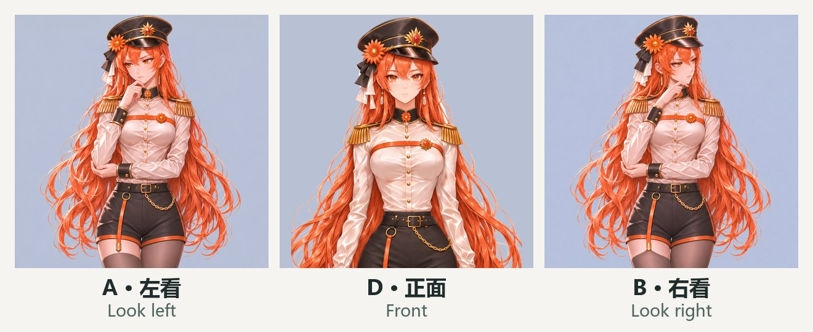
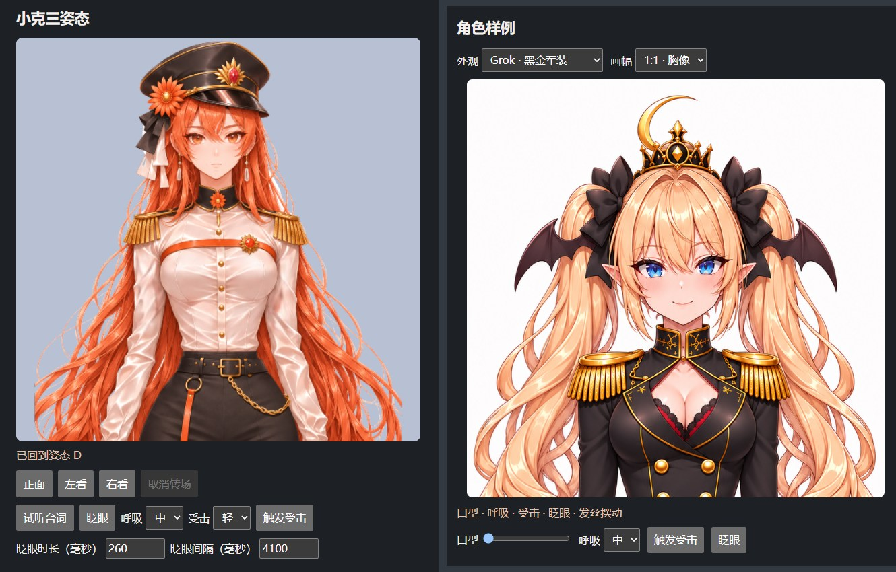
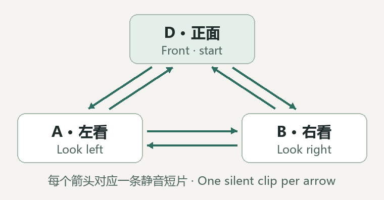
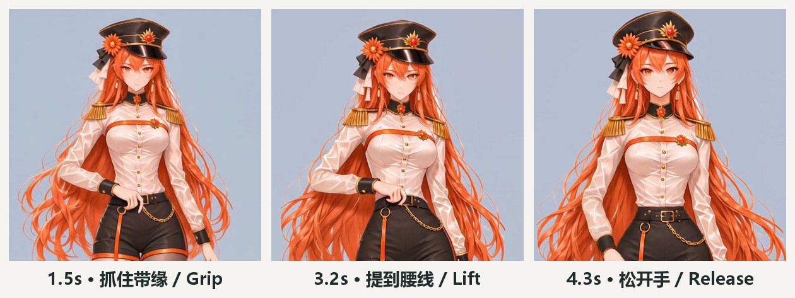
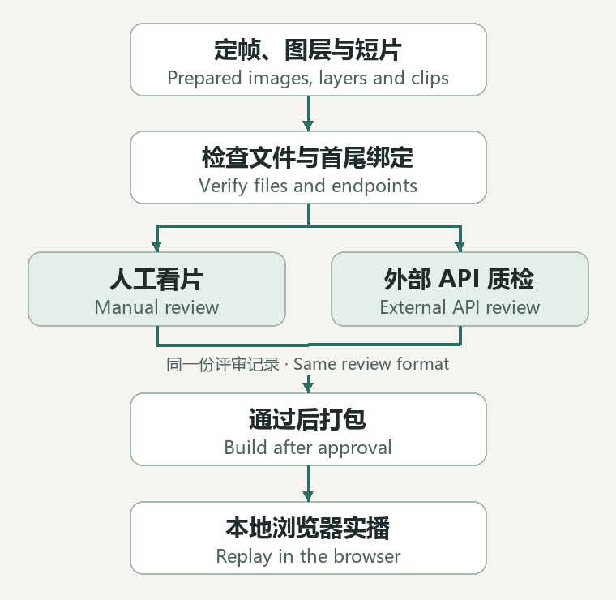

# PoseRelay

[简体中文](README.md) · English

**Make 2D characters that speak, idle, and change poses.** Real-time layers drive lip sync, blinking, breathing, impact reactions, and fringe motion. Pre-rendered clips handle pose changes, then hand control back to the destination pose. The work of generating those clips happens during production.



Claude is the complete example, with three poses and six directed transitions. [Watch her lift her belt as she turns back to the front](docs/media/belt-lift.webp). The portrait gallery includes four characters, seven looks, and 21 fixed views. Playback and packaging work offline. Manual review makes zero API calls.

## Run the demos in a minute

You need Python 3.10+ and a modern browser with Canvas, Web Audio, and H.264 MP4 support. Clone the repository or unpack the ZIP from [GitHub Releases](https://github.com/li1fang/PoseRelay/releases/latest). Run this from the folder containing this README and `canteen.py`. On Windows, use `py` in place of `python` if that is how you launch Python.

```sh
python -m http.server 8000 --bind 127.0.0.1
```

| Demo | Try this first |
| --- | --- |
| [Claude pose player](http://127.0.0.1:8000/examples/claude/) | Click **右看** (look right), wait for the pose to settle, then click **试听台词** (play a test line). Click **正面** (front) to see her lift her belt as she turns back. All three poses let you adjust breathing, trigger an impact, and set blink duration and interval separately. |
| [Portrait gallery](http://127.0.0.1:8000/examples/portraits/) | Choose a look, switch between `1:1`, `1:2`, and `2:1`, and drag the **口型** (mouth shape) slider. Breathing, impacts, blinks, and hair motion depend on the view. |



## How pose changes work



Each clip represents one direction of travel. In **B→D**, the belt sits lower in the right-facing pose, so Claude lifts it to her waist as she turns. When she arrives at D, the player resumes D's lip sync, blink, and fringe layers.



[Watch the complete silent B→D clip as an animated image](docs/media/belt-lift.webp)

## Build with your own assets

The goal is an automated production pipeline that prepares assets, assembles them, and packages the results for human review and approval. This release starts with prepared assets and provides validation, review records, packaging, and playback. Use `examples/claude/` and its `manifest.json` as a template with these inputs.

- **Poses.** Use three square PNGs for A, B, and D, each with aligned mouth, eye, and fringe layers plus impact and breathing data.
- **Transitions.** Supply one 512 × 512 MP4 per direction at a constant 24 fps. Include a single video track and list the starting and ending pose fingerprints in that order.
- **Voice.** Supply `short.wav` and `long.wav` for the demo lines.

For multiple looks or aspect ratios, use `examples/portraits/` as the template and try lip sync on one fixed view first.



Try the commands on the included Claude example first. The inspection checks file fingerprints, dimensions, layer bounds, audio, and clip format. It also checks that the declared endpoints match the registered poses.

```sh
python canteen.py inspect examples/claude work/claude-inventory.json
python canteen.py review-template work/claude-inventory.json work/claude-review.json --mode manual
```

Open `work/claude-review.json`, fill in `reviewer`, and set each item's `decision` to `approved`, `rejected`, or `pending` after reviewing it. Keep the original `sha256`. If the belt jumps at 2.4 seconds in B→D, for example, mark the clip `rejected`, set `seconds` to `2.4`, and describe the jump in `note`. After replacing assets, rerun the two commands. Previous decisions carry over for items with the same fingerprint and review mode.

```sh
python canteen.py build examples/claude work/claude-review.json work/claude-ready
```

Once all items pass review, open the [rebuilt Claude example](http://127.0.0.1:8000/work/claude-ready/) and try it in the browser. The output's `receipt.json` records the asset version, review mode, and review fingerprint. Choose a fresh output directory for each build. To review and rebuild the gallery, substitute `portraits` for `claude` in the example paths and output names.

### Review options

| Option | How to use it |
| --- | --- |
| Manual review (default) | Watch the full transition at normal speed, then check the eyes, mouth, hands, and garment edges. Record decisions directly in the JSON file. |
| External API review | Use your own review service on the clip or selected regions. Generate the review record with `review-template ... --mode api` and fill in its decisions. Both modes use the same build command. |

`canteen.py` uses the Python standard library. It makes no calls to generation or review services. API mode consumes review decisions from an external service. The demos and their assets load from the local HTTP server.

## Further reading

- [Example assets and coverage](ASSETS.md) lists provenance, aspect ratios, and the effects supported by each look (Chinese).
- [Release notes](RELEASE.md) describe what's included and what was tested.
- [MIT License](LICENSE) covers the code, documentation, and project-created examples.
