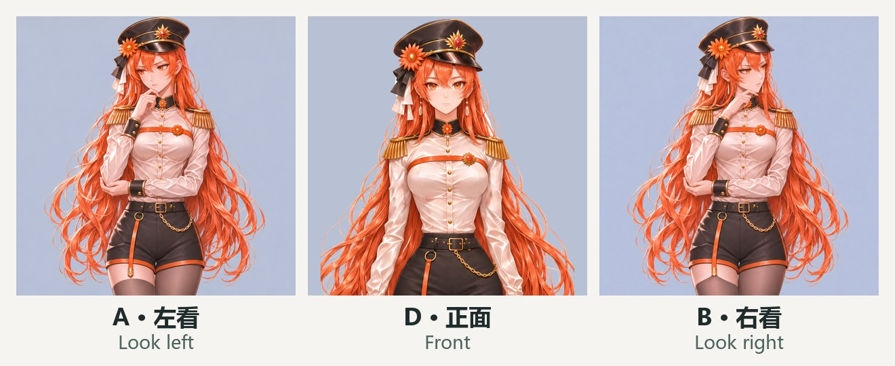
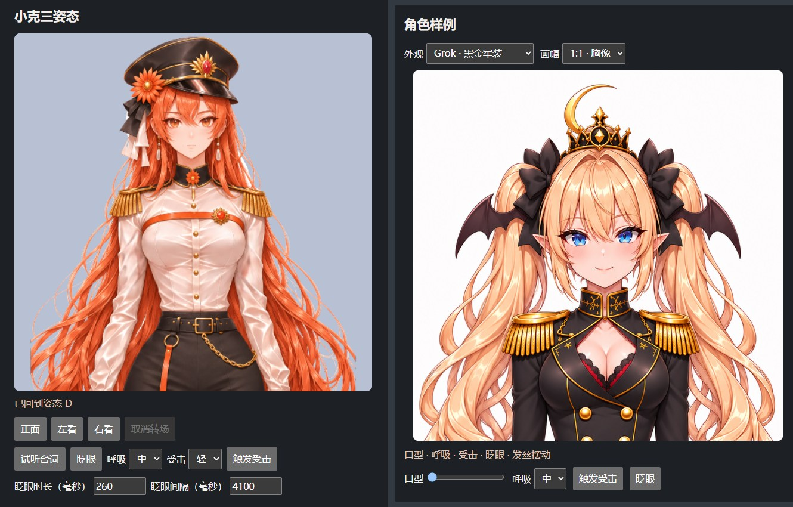
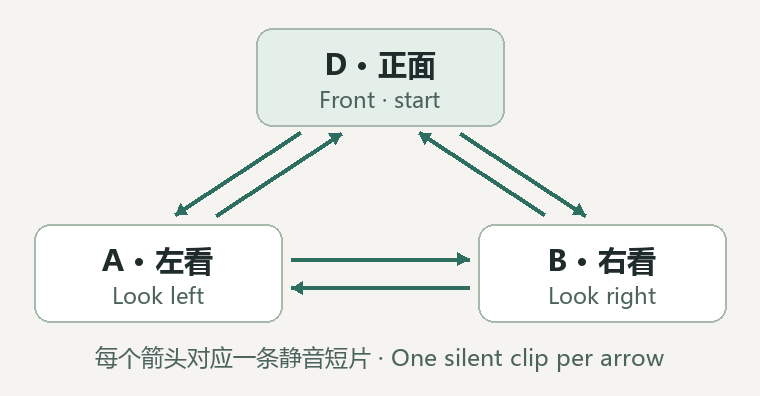
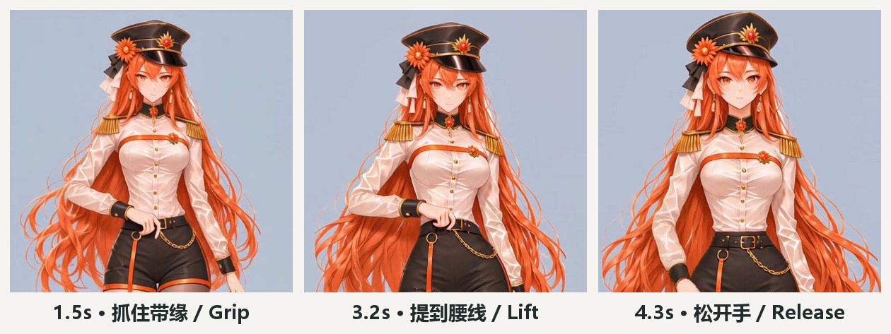
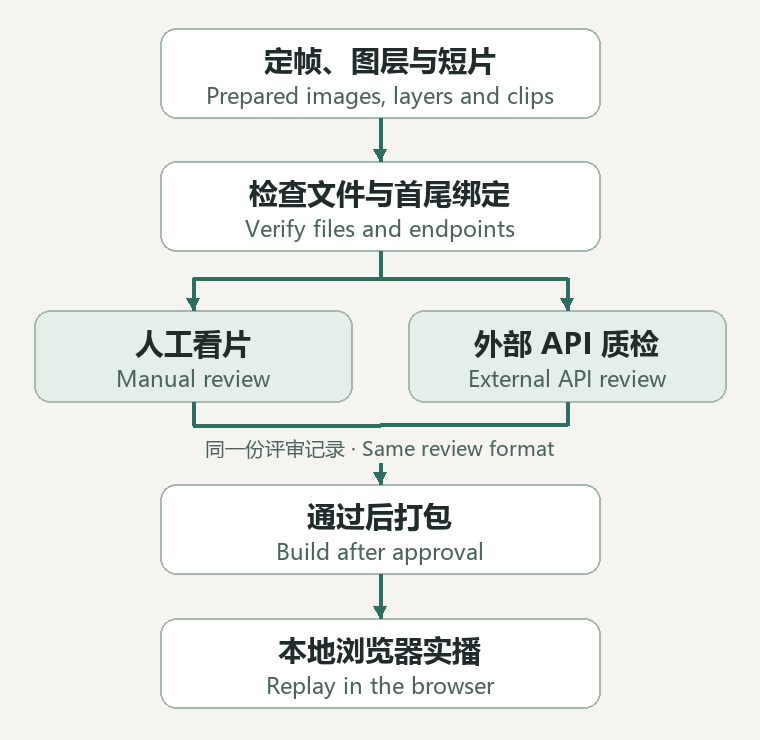

# PoseRelay · 姿态接力

简体中文 · [English](README.en.md)

**让 2D 角色开口说话，也能自然地换个姿态。** 口型、眨眼、呼吸、受击和刘海摆动由实时图层驱动。换姿态时播放预生成短片，到位后继续实时驱动。生成计算留在制作阶段。



小克是完整样例，三种姿态之间共六条转场。[看她抬腰带回到正面](docs/media/belt-lift.webp)。角色库还提供四位角色、七套外观和 21 个固定画面。播放和打包可离线进行，人工看片模式不产生 API 请求。

**[打开网页试玩](https://li1fang.github.io/PoseRelay/examples/claude/)**。小克会自行待机。你可以点一下胸部任意一侧，试听台词，或者让她换个姿态。网页无需登录或填 API 密钥。

## 一分钟跑起来

需要 Python 3.10+ 和支持 Canvas、Web Audio、H.264 MP4 的现代浏览器。克隆仓库，或解压 [GitHub Releases](https://github.com/li1fang/PoseRelay/releases/latest) 上的 ZIP。从包含本 README 和 `canteen.py` 的目录运行。Windows 上若 Python 命令是 `py`，把示例中的 `python` 换成 `py`。

```sh
python -m http.server 8000 --bind 127.0.0.1
```

| 打开样例 | 第一次可以这样试 |
| --- | --- |
| [小克三姿态](http://127.0.0.1:8000/examples/claude/) | 点「右看」，到位后点「试听台词」。点「正面」看她提腰带回正。「动画控制」可手动调参数，「录制排演」可导入本地 WAV。 |
| [角色样例](http://127.0.0.1:8000/examples/portraits/) | 选外观，切换 `1:1`、`1:2`、`2:1`，拖「口型」滑杆。呼吸、受击、眨眼和发丝按该画面的能力开放。 |



## 换姿态是怎么做的



每条短片对应一个有方向的切换。以 **B→D** 为例，右看的定帧里腰带偏低，回正时让小克用手把带缘提到腰线。抵达 D 后，她就可以按 D 的口型、眨眼和刘海图层继续表演。



[看完整 B→D 静音动图](docs/media/belt-lift.webp)

## 用自己的素材打包

长远目标是由流水线准备素材、装配和打包，人只审看和决定采用哪些结果。本版从准备好的素材开始，提供自动结构校验、评审记录、打包和播放。用 `examples/claude/` 和它的 `manifest.json` 作为模板时，沿用以下格式。

- **姿态**。用 A、B、D 三张方形 PNG 定帧，分别配上同画布的嘴、眼、刘海和受击／呼吸数据。
- **转场**。每个方向一条 512 × 512、24 fps 的恒定帧率 MP4，仅有视频轨。在清单按顺序登记首尾定帧指纹。
- **语音**。用 `short.wav` 和 `long.wav` 试听。

已有多外观或多画幅素材时，可以改用 `examples/portraits/` 作为模板，从单个固定画面测试口型。



第一次建议直接用随包的小克样例复跑。检查会核对素材指纹、尺寸、图层范围、语音和转场格式，也会核对每段转场登记的首尾绑定。

```sh
python canteen.py inspect examples/claude work/claude-inventory.json
python canteen.py review-template work/claude-inventory.json work/claude-review.json --mode manual
```

打开 `work/claude-review.json`，填写 `reviewer`，看完后把每项 `decision` 填为 `approved`、`rejected` 或 `pending`。保留原 `sha256`。例如 B→D 的腰带在第 2.4 秒突然跳高，可以登记 `rejected`、`seconds: 2.4`，在 `note` 写明问题。替换素材后再运行上面两条命令，指纹与评审模式相同的项目会保留原判定。

```sh
python canteen.py build examples/claude work/claude-review.json work/claude-ready
```

全部项目通过后，打开 [重新打包的小克](http://127.0.0.1:8000/work/claude-ready/) 实播。检查输出中的 `receipt.json`，它会记录素材版本、评审模式和回执指纹。再次打包时给输出目录换个新名字。检查角色库时可把命令中样例路径和输出名里的 `claude` 换为 `portraits`。

### 两种质检方式

| 方式 | 怎么用 |
| --- | --- |
| 人工看片（默认） | 看原速转场，再检查眼、嘴、手和服装边缘。把结果直接写回 JSON。 |
| 外部 API 评审 | 用自己的评审服务看片或检查局部。用 `review-template ... --mode api` 生成评审记录并填入结论。两种方式共用打包命令。 |

`canteen.py` 只使用 Python 标准库，也不会调用生成或审图服务。API 模式接收外部评审结果。样例和播放器都由本地 HTTP 服务加载。

## 继续读

- [样例与能力清单](ASSETS.md) 列出各角色的素材来源、画幅、动效与覆盖范围。
- [发布说明](RELEASE.md) 记录本版提供的能力和运行测试。
- [MIT 许可证](LICENSE) 随源码、文档和项目制作的样例一同发布。
